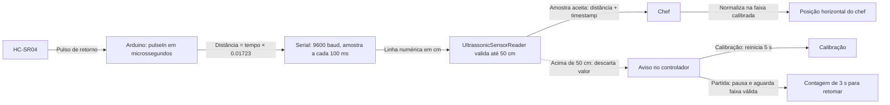

# Activity 1: Leitura do HC-SR04 e movimento do chef

## Contexto

O HC-SR04 fornece um pulso Echo cuja duração representa o tempo de ida e volta do som. O Arduino converte a duração para centímetros e publica uma amostra por linha serial. O jogo recebe essas linhas em uma thread própria para não bloquear o ciclo de renderização.

## Objetivo

Mostrar como a leitura física é convertida, transportada até o jogo e mapeada para a posição horizontal do chef.

## Estrutura de Implementação

### Fluxo da leitura



### Sketch Arduino

No arquivo [ultrassonic_reader.ino](../../../ultrassonic_reader/ultrassonic_reader.ino), o pino 13 dispara o pulso e o pino 12 recebe o Echo. A conversão usa aproximadamente 0,01723 centímetros por microssegundo, já dividindo por dois o percurso de ida e volta. Como distância é um inteiro, a transmissão descarta a parte fracionária do resultado.

```cpp
int distancia = 0;

long readUltrasonicDistance(int triggerPin, int echoPin) {
  pinMode(triggerPin, OUTPUT);
  digitalWrite(triggerPin, LOW);
  delayMicroseconds(2);
  digitalWrite(triggerPin, HIGH);
  delayMicroseconds(10);
  digitalWrite(triggerPin, LOW);
  pinMode(echoPin, INPUT);
  return pulseIn(echoPin, HIGH);
}

void setup() {
  Serial.begin(9600);
}

void loop() {
  distancia = 0.01723 * readUltrasonicDistance(13, 12);
  Serial.println(distancia);
  delay(100);
}
```

### Leitura serial Java

[UltrassonicSensorReader.java](../../../core/src/main/java/games/project/desability_geometry_dash/UltrassonicSensorReader.java) abre a porta configurada e lê as linhas em segundo plano. Antes de publicar uma amostra, rejeita valores acima de 50 cm. O trecho guarda somente o timestamp do valor recusado:

```java
String line = reader.readLine();
if (line != null) {
    int distanceCm = Integer.parseInt(line.trim());
    long timestampNanos = System.nanoTime();
    if (distanceCm > MAX_DISTANCE_CM) {
        latestOutOfRangeTimestampNanos = timestampNanos;
    } else {
        latestReading = new Reading(distanceCm, timestampNanos);
    }
}
```

### Conversão para movimento

Após a preparação, GameController calibra a distância mínima e máxima. Chef transforma a amostra válida em uma fração entre zero e um e multiplica essa fração pela largura disponível do mundo:

```java
float normalized = MathUtils.clamp(
    (sensor.getDistance() - minDistance) / amplitude, 0f, 1f
);
float targetX = normalized * (viewport.getWorldWidth() - sprite.getWidth());
```

Uma distância próxima do mínimo leva o chef para a esquerda; uma distância maior leva-o para a direita. A interpolação suaviza a transição entre amostras.

Na calibração, uma leitura acima do limite reinicia a contagem de cinco segundos e exibe o aviso para manter o braço na linha de visão. Durante a partida, o jogo congela a fase; quando uma leitura positiva de até 50 cm volta a chegar, exibe uma contagem de três segundos antes de retomar.

## Critérios de Aceite

- [ ] O diagrama mostra sensor, Arduino, serial, leitor Java e chef.
- [ ] Os trechos correspondem ao sketch e às classes atuais.
- [ ] A documentação distingue a duração do pulso em microssegundos da distância transmitida em centímetros.
- [ ] Valores acima de 50 cm são descartados antes de atualizar a amostra consumida pelo jogo.

## Referências

- [ADR-001: HC-SR04 pela serial](../../adr/001-read-hcsr04-over-serial.md)
- [ultrassonic_reader.ino](../../../ultrassonic_reader/ultrassonic_reader.ino)
- [UltrassonicSensorReader.java](../../../core/src/main/java/games/project/desability_geometry_dash/UltrassonicSensorReader.java)
- [Chef.java](../../../core/src/main/java/games/project/desability_geometry_dash/Chef.java)
- [GameController.java](../../../core/src/main/java/games/project/desability_geometry_dash/GameController.java)
