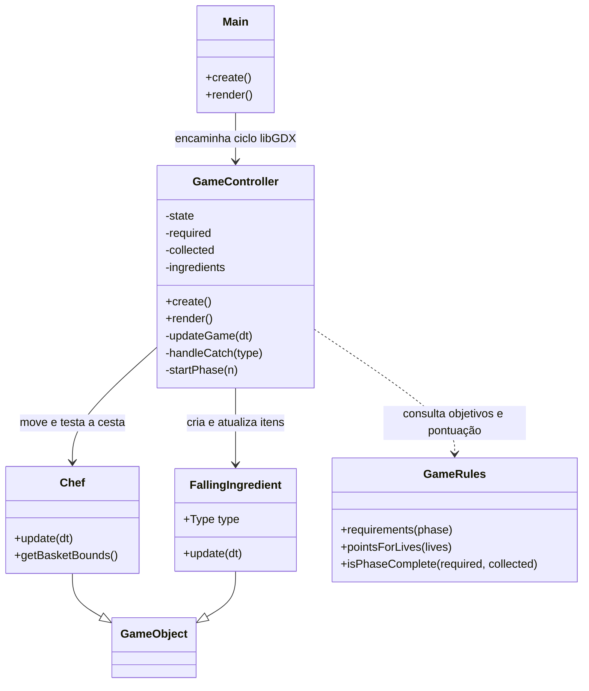

# Activity 2: Receita de padeiro e coleta de ingredientes

## Contexto

O jogo transforma o movimento horizontal do braço em controle da cesta do chef. Ingredientes caem pela tela; coletar os itens pedidos avança a receita, enquanto itens incorretos ou extras consomem vidas. A receita é organizada em três fases com uma lista que cresce gradualmente.

## Objetivo

Descrever como as entidades e as regras trabalham juntas para conduzir o jogador da primeira coleta ao bolo final.

## Estrutura de Implementação

### Principais classes



### Receita por fase

| Fase do jogo | Ingredientes exigidos |
|--------------|-----------------------|
| 1 | 3 ovos, 2 porções de farinha, 3 cenouras e 1 açúcar |
| 2 | Itens da fase 1 e 1 fermento |
| 3 | Itens da fase 2 e 1 chocolate |

GameRules cria o mapa de requisitos. O trecho abaixo mostra a inclusão dos ingredientes das fases posteriores e a seleção dos itens que ainda são necessários:

```java
if (phase >= 2) required.put(FallingIngredient.Type.YEAST, 1);
if (phase >= 3) required.put(FallingIngredient.Type.CHOCOLATE, 1);

for (FallingIngredient.Type type : required.keySet())
    if (collected.getOrDefault(type, 0) < required.get(type)) needed.add(type);
```

Chef lê a distância do sensor, movimenta a cesta e expõe seus limites para a colisão. FallingIngredient guarda seu tipo e velocidade de queda. GameController compara a colisão com a lista atual; ao completar os requisitos, encerra a fase e avança. A terceira fase leva à tela final do bolo.

## Critérios de Aceite

- [ ] O diagrama identifica as classes principais e mostra suas relações.
- [ ] A tabela registra a progressão dos ingredientes nas três fases.
- [ ] A coleta, a validação dos objetivos e o encerramento da fase estão descritos.

## Referências

- [ADR-002: Receita de padeiro em fases](../../adr/002-progressive-baker-recipe.md)
- [GameController.java](../../../core/src/main/java/games/project/desability_geometry_dash/GameController.java)
- [GameRules.java](../../../core/src/main/java/games/project/desability_geometry_dash/GameRules.java)
- [Chef.java](../../../core/src/main/java/games/project/desability_geometry_dash/Chef.java)
- [FallingIngredient.java](../../../core/src/main/java/games/project/desability_geometry_dash/FallingIngredient.java)
