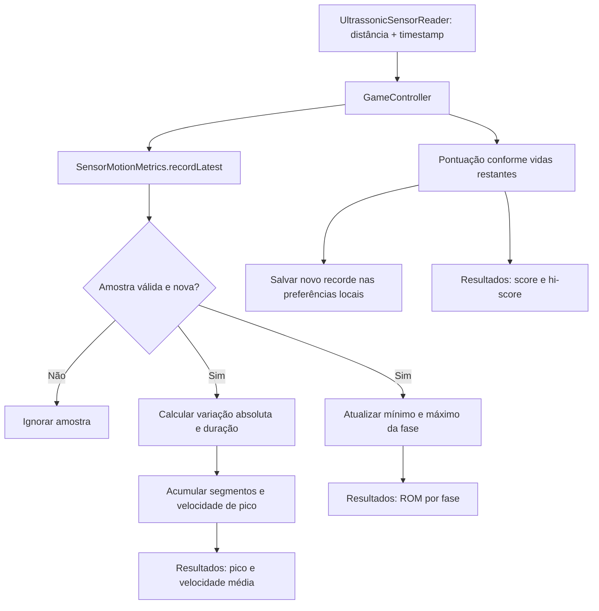

# Activity 3: Métricas de movimento e desempenho

## Contexto

O leitor serial fornece a distância e um timestamp monotônico. Essas amostras permitem resumir a faixa de movimento observada em cada fase e estimar a velocidade. A partida também calcula pontuação com base nas vidas restantes.

## Objetivo

Documentar os valores exibidos ao final do jogo e a responsabilidade de SensorMotionMetrics.java.

## Estrutura de Implementação

### Fluxo das métricas



### Definições

| Métrica | Cálculo ou regra |
|---------|------------------|
| Pontuação | Item correto concede 5 pontos com 3 vidas, 3 pontos com 2 vidas e 1 ponto com 1 vida. |
| ROM por fase | Distância máxima observada menos distância mínima observada naquela fase. |
| Velocidade de pico | Maior velocidade válida observada entre as amostras ou ao fechar um segmento. |
| Velocidade média | Distância total acumulada dividida pela duração total dos segmentos acumulados. |

O recorde é salvo em Preferences do libGDX. As demais métricas de movimento são acumuladas em memória e apresentadas na tela de resultados.

### Acumulação de movimento

UltrassonicSensorReader descarta valores acima de 50 cm antes de atualizar a amostra disponível. SensorMotionMetrics também rejeita distâncias fora desse limite, além de timestamps inválidos, distâncias não positivas e amostras repetidas. A mudança de direção fecha o segmento em curso. Variações inferiores a 1 cm não aumentam a distância acumulada; se já existe um segmento, o tempo entre amostras ainda é contabilizado.

```java
float elapsed = (timestamp - previousTimestampNanos) / 1_000_000_000f;
float traveled = Math.abs(distance - previousDistance);
if (distance <= UltrassonicSensorReader.MAX_DISTANCE_CM && elapsed > 0f) {
    if (traveled >= MIN_MOVEMENT_DELTA_CM) {
        segmentDistanceCm += traveled;
        segmentDurationSeconds += elapsed;
        peakVelocityCmPerSecond = Math.max(
            peakVelocityCmPerSecond, traveled / elapsed
        );
    }
}
```

## Critérios de Aceite

- [ ] A ROM está descrita como diferença entre máximo e mínimo por fase.
- [ ] A distinção entre pico e velocidade média está clara.
- [ ] A regra de pontuação e o armazenamento local do recorde estão descritos.
- [ ] O diagrama mostra a leitura, validação, acumulação e apresentação das métricas.

## Referências

- [ADR-004: Métricas de movimento e desempenho](../../adr/004-collect-gameplay-metrics.md)
- [SensorMotionMetrics.java](../../../core/src/main/java/games/project/desability_geometry_dash/SensorMotionMetrics.java)
- [GameController.java](../../../core/src/main/java/games/project/desability_geometry_dash/GameController.java)
- [UltrassonicSensorReader.java](../../../core/src/main/java/games/project/desability_geometry_dash/UltrassonicSensorReader.java)
