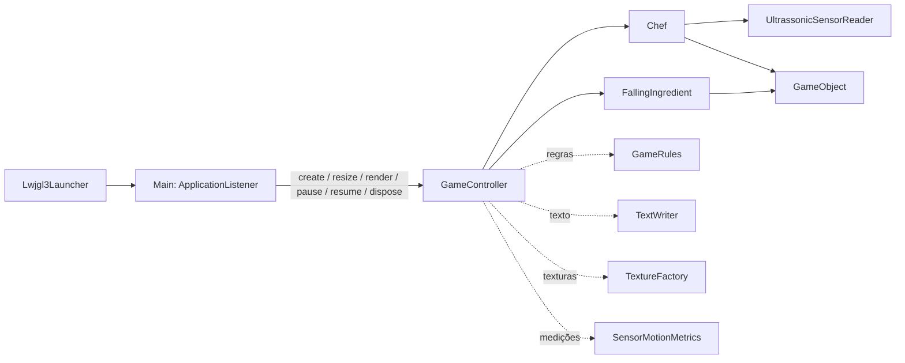

# Activity 4: Simplificação de Main

## Contexto

Main acumulava callbacks do libGDX, estado da partida, entrada de teclado, regras, coleta, sensor e desenho. Essa concentração dificultava localizar responsabilidades e alterava a classe por motivos diferentes.

## Objetivo

Documentar a arquitetura após a refatoração: Main encaminha o ciclo de vida, GameController coordena a partida e os componentes auxiliares cuidam de responsabilidades específicas.

## Estrutura de Implementação

### Arquitetura



### Encaminhamento do ciclo de vida

Main mantém somente os callbacks exigidos pela aplicação e os encaminha ao controlador:

```java
@Override
public void render() {
    game.render();
}
```

GameController coordena os estados e chama os componentes diretamente nos pontos de uso. Por exemplo, o desenho chama TextWriter e a validação da receita chama GameRules:

```java
TextWriter.draw(batch, font, text, x, y, scale, color);
if (GameRules.isPhaseComplete(required, collected)) {
    finishPhase();
}
```

Regras ficam em GameRules, operações de texto em TextWriter, preparação de imagens em TextureFactory e acumulação de movimento em SensorMotionMetrics. Chef, FallingIngredient e GameObject representam entidades do jogo.

## Critérios de Aceite

- [ ] Main não contém métodos privados nem regras da partida.
- [ ] Os callbacks do libGDX são encaminhados diretamente a GameController.
- [ ] O diagrama mostra o controlador e os componentes especializados.
- [ ] Chamadas a regras, texto, texturas e métricas são feitas diretamente nos pontos de uso.

## Referências

- [ADR-005: Separar ponto de entrada e controlador](../../adr/005-separate-entrypoint-and-game-controller.md)
- [Main.java](../../../core/src/main/java/games/project/desability_geometry_dash/Main.java)
- [GameController.java](../../../core/src/main/java/games/project/desability_geometry_dash/GameController.java)
- [GameRules.java](../../../core/src/main/java/games/project/desability_geometry_dash/GameRules.java)
- [TextWriter.java](../../../core/src/main/java/games/project/desability_geometry_dash/TextWriter.java)
- [TextureFactory.java](../../../core/src/main/java/games/project/desability_geometry_dash/TextureFactory.java)
- [SensorMotionMetrics.java](../../../core/src/main/java/games/project/desability_geometry_dash/SensorMotionMetrics.java)
